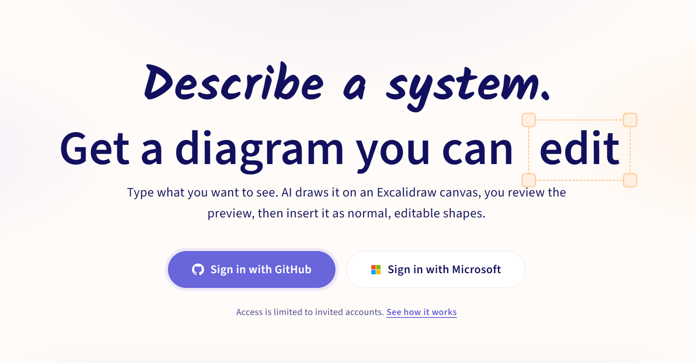
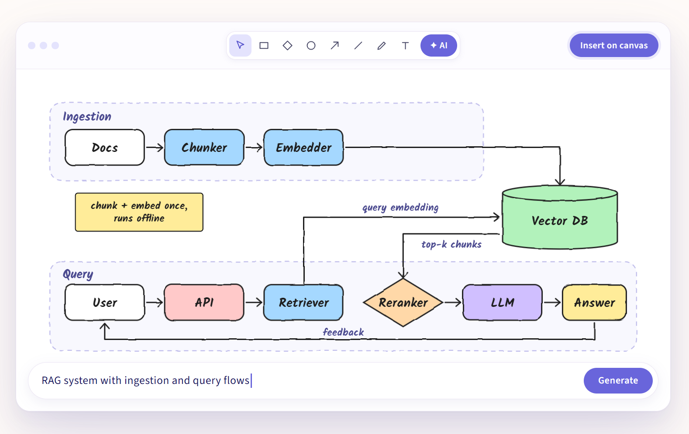
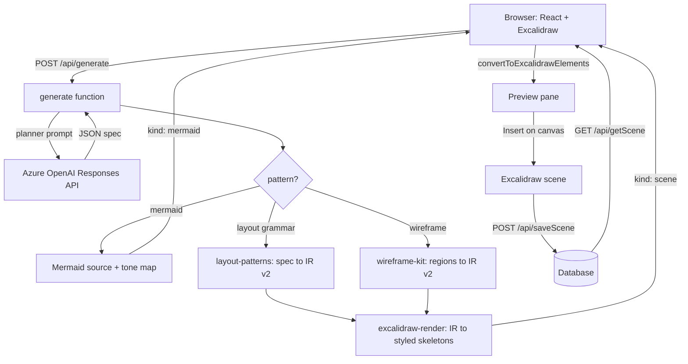

# Layr

> Describe a system. Get a diagram you can edit.

Layr is a private diagramming workspace built on the open-source
[Excalidraw](https://github.com/excalidraw/excalidraw) library. You describe
what you want to see, an LLM plans it, deterministic code lays it out, and the
result lands on the canvas as normal, editable Excalidraw shapes. It works in
Excalidraw's native light and dark themes. Workspaces are saved to a database
behind an invite-only sign-in.





---

## Table of contents

- [Layr](#layr)
  - [Table of contents](#table-of-contents)
  - [Credit and relationship to Excalidraw](#credit-and-relationship-to-excalidraw)
  - [Features](#features)
  - [How it works](#how-it-works)
  - [Diagram types](#diagram-types)
  - [Colour and themes](#colour-and-themes)
  - [Tech stack](#tech-stack)
  - [Project structure](#project-structure)
  - [Getting started](#getting-started)
    - [Prerequisites](#prerequisites)
    - [Install](#install)
    - [Configure](#configure)
    - [Run locally](#run-locally)
  - [Configuration](#configuration)
  - [API reference](#api-reference)
    - [`POST /api/generate`](#post-apigenerate)
    - [`GET /api/listScenes`](#get-apilistscenes)
    - [`GET /api/getScene?topic=<name>`](#get-apigetscenetopicname)
    - [`POST /api/saveScene`](#post-apisavescene)
  - [Data model](#data-model)
  - [Authentication and access control](#authentication-and-access-control)
  - [Deployment](#deployment)
  - [Limits and security notes](#limits-and-security-notes)
  - [Roadmap](#roadmap)
  - [License](#license)
  - [Acknowledgements](#acknowledgements)

---

## Credit and relationship to Excalidraw

This project would not exist without Excalidraw. The infinite canvas, drawing
tools, hand-drawn rendering, element format, import and export, and the
Mermaid conversion (`@excalidraw/mermaid-to-excalidraw`) all come from the
Excalidraw team and its contributors, and are used under the MIT License.

This is an **independent project. It is not affiliated with or endorsed by
Excalidraw.** Excalidraw+ is the official hosted product from the Excalidraw
team and offers similar features, including AI diagrams. This repository is a
self-built version on top of the open-source library, made for learning and for
running your own private instance. If you want the official experience, use
[Excalidraw+](https://plus.excalidraw.com).

| From Excalidraw | Built in this project |
| --- | --- |
| Infinite canvas and drawing tools | Text-to-diagram planning and layout engine |
| Hand-drawn look and shape library | Semantic colour system that works in light and dark |
| Element format, import and export | Edit a generated diagram by selecting it |
| Mermaid to Excalidraw conversion | Saved workspaces, invite-only sign-in, landing page |

## Features

- **Text to diagram.** Describe an architecture, process, comparison, concept,
  layered network, hierarchy, UI screen or an article-style explainer. Short
  prompts are fine; the planner infers a sensible scope.
- **The model never draws coordinates.** It chooses a diagram grammar and fills
  in meaning (labels, groups, edges, tones). Code owns every position, size,
  gap and arrow port, so layouts are consistent and text fits its boxes.
- **Twelve layout grammars plus Mermaid.** Pipelines, flowcharts, tiers,
  swimlanes, cards, comparisons, neural-network layers, composites, trees, hubs,
  cycles and UI wireframes. Sequence, ER, class and state diagrams go through
  Mermaid. See [Diagram types](#diagram-types).
- **Semantic colour.** The model picks a meaning (`accent`, `danger`, `warn`,
  `info`, `violet`, `success`, `muted`, `default`), never a colour. One palette
  renders it, and it looks right in both Excalidraw themes.
- **Native light and dark.** Generated elements stay correct when you toggle
  Excalidraw's theme, before or after generating. The AI panel and its preview
  follow the editor theme too. See [Colour and themes](#colour-and-themes).
- **Preview before insert.** Output opens in a review pane. The canvas is
  untouched until you click **Insert on canvas**.
- **Edit by selection.** Select any element of a generated diagram, switch to
  **Edit selection**, and describe the change. Only that diagram is replaced, and
  ids stay stable.
- **Many diagrams per canvas.** Each generated diagram keeps its own source and
  element ids, so several can live next to ordinary hand-drawn work.
- **Saved workspaces.** Name a workspace, save it, reopen it later. Generated
  diagrams stay editable by prompt after a reload.
- **Invite-only access.** GitHub or Microsoft sign-in, restricted to invited
  accounts with a custom role.
- **Landing page** in the Excalidraw style with a light/dark toggle and credits.

## How it works



1. **Plan.** The browser sends your instruction to `/api/generate`. The planner
   prompt is generated from the pattern catalogue in code, so documentation and
   behaviour cannot drift. The model returns one JSON object: a pattern plus
   semantic slots, or Mermaid source for diagram types that suit it.
2. **Validate.** `validatePatternSpec` checks ids, group membership, edge
   endpoints and size limits. Invalid specs never reach the layout engine.
3. **Lay out.** `specToOperations` (or `wireframeToOperations`) turns the spec
   into IR v2 operations on an 8px grid: text-aware node sizes, rank/grid/ring
   layouts, group containers, title block, notes, and arrow ports and anchors.
4. **Render.** `irToElements` turns IR into Excalidraw element skeletons with
   tones, hand-drawn style, dashed containers and bound arrows. Mermaid results
   are styled on the client with the same palette (`applyMermaidSemanticStyles`).
5. **Convert and preview.** The client runs `convertToExcalidrawElements`,
   centres the batch on the viewport (or on the diagram being replaced) and shows
   a preview with an element and connector count.
6. **Insert and save.** Insert merges the elements into the scene. Edits replace
   only the selected diagram's elements. Saving stores the scene plus the
   generated-diagram metadata.

**Fallbacks.** If the planner's spec is invalid or cannot be laid out, a second
call asks for a text-card composition. If that also fails, the user gets an
error asking for a more specific request. Mermaid is only used when the planner
selects it.

**Create vs edit.** Creating is always independent of what is on the canvas.
Editing sends the selected diagram's saved source: Mermaid diagrams are edited
through the Mermaid path, grammar-based diagrams are re-planned from their saved
spec with stable ids.

## Diagram types

| Pattern | Use it for |
| --- | --- |
| `pipeline` | Linear ordered steps: ETL, request lifecycle, CI/CD |
| `flow` | Flowcharts and DAGs with branches, decisions, merges, loop-backs |
| `tiers` | Layered architecture, OSI, network zones |
| `swimlane` | Cross-actor processes: customer / system / database lanes, handshakes |
| `cards` | Concept explanations, key points, pros/cons, options, summaries |
| `comparison` | Two alternatives aligned row by row (A vs B) |
| `layers-net` | Neural networks. Dense edges are drawn by code, never listed by the model |
| `composite` | Hybrids with several regions and cross-region edges |
| `tree` | Hierarchies: taxonomy, org chart, decomposition |
| `hub` | One central concept with spokes and no sequence |
| `cycle` | Genuine loops: training loop, PDCA, event loop, lifecycle |
| `wireframe` | UI screens composed from 19 primitives (heading, button, input, card, chart, table, navigation, tabs and more) in free-form regions |
| `mermaid` | Sequence, ER, class and state diagrams, and Mermaid flowcharts when the planner chooses them |

Roles (`hero`, `primary`, `secondary`, `supporting`, `external`, `decision`)
drive node size and shape: decisions become diamonds, external actors become
ellipses. Notes appear in a column beside the diagram, or below it when the
diagram is very wide.

## Colour and themes

**Generated colours are theme-independent by design.** Excalidraw stores element
colours in one canonical (light) form and re-colours them itself in dark mode
with an invert and hue-rotate transform. Layr therefore always emits one
light-palette set of colours. The same elements look right in both themes and
keep looking right if you switch themes after generating. Baking a dark palette
into elements would be inverted a second time and become unreadable.

The semantic tones, defined in `api/excalidraw-render.js`:

| Tone | Meaning | Stroke | Fill |
| --- | --- | --- | --- |
| `default` | Everything else | `#1e1e1e` | none |
| `accent` | The focal or primary component | `#2f9e44` | `#d3f9d8` |
| `danger` | Risk, failure, critical or hardware | `#e03131` | `#ffe3e3` |
| `warn` | Decisions and caution | `#e8590c` | `#fff4e6` |
| `info` | Inputs, sources, a distinct layer | `#1971c2` | `#d0ebff` |
| `violet` | Storage, a distinct layer | `#6741d9` | `#e5dbff` |
| `success` | Outputs and completed states | `#2f9e44` | `#b2f2bb` |
| `muted` | External or optional | `#868e96` | `#f1f3f5` |

If the model gives no tone, one is inferred from the node's role, then from label
keywords (for example "database", "error", "client"), then cycled by group.
Edges use `#343a40`, dense layer-to-layer edges are drawn thin and faint, and
group containers are dashed.

Checked against Excalidraw's dark transform, text on every tone fill measures
about 7:1 contrast or better, and strokes stay above about 4:1 against the dark
canvas.

**The AI interface follows the editor theme.** The launcher, modal, chat,
composer and preview use CSS variables defined in `AIWorkspacePanel.css`. Light
values sit on `.editor-shell`; the dark set applies when the shell has the
`theme--dark` class, which the editor keeps in sync with Excalidraw's theme. In
dark mode the preview applies the same transform Excalidraw uses, on Excalidraw's
dark canvas colour, so the preview matches what Insert produces.

**The landing page has its own toggle.** It starts from the OS setting and
remembers the choice in `localStorage` under `ai-diagram-landing-theme`. It is
independent of the editor theme.

## Tech stack

| Layer | Choice |
| --- | --- |
| UI | React, TypeScript, Vite |
| Canvas | `@excalidraw/excalidraw`, `@excalidraw/mermaid-to-excalidraw` |
| API | Azure Functions (Node.js, v4 programming model) |
| LLM | Azure OpenAI through the `openai` SDK, Responses API with JSON output |
| Auth and hosting | Azure Static Web Apps (GitHub and Microsoft sign-in) |
| Storage | A database behind the Functions API |

## Project structure

Adjust to match your tree.

```text
.
├── src/
│   ├── App.tsx               # Routing, editor, AI modal, preview, save/load
│   ├── LandingPage.tsx       # Landing and sign-in page
│   ├── Landing.css           # Landing styles, scoped under .lp, light and dark
│   ├── AIWorkspacePanel.css  # AI launcher, modal and preview, light and dark
│   ├── App.css               # Editor shell styles
│   └── index.css             # Global resets
├── api/
│   ├── generate.js           # HTTP function: prompts, LLM calls, orchestration
│   ├── layout-patterns.js    # Pattern catalogue, validation, layout engine
│   ├── wireframe-kit.js      # UI wireframe composition from primitives
│   ├── excalidraw-render.js  # Tones, palette, IR to Excalidraw skeletons
│   └── ...                   # listScenes, getScene, saveScene
├── public/
│   └── no-access.html        # Shown to signed-in users who are not invited
├── staticwebapp.config.json  # Routes, roles and headers
└── README.md
```

Routing is deliberately simple: `/editor` and `/editor/*` render the editor,
everything else renders the landing page.

## Getting started

### Prerequisites

- Node.js 20 or newer
- An Azure OpenAI resource with a deployed model
- A GitHub or Microsoft account for sign-in
- [Azure Static Web Apps CLI](https://github.com/Azure/static-web-apps-cli) and
  [Azure Functions Core Tools](https://learn.microsoft.com/azure/azure-functions/functions-run-local)
  for running locally

### Install

```bash
git clone <your-repo-url>
cd <your-repo>
npm install
(cd api && npm install)
```

### Configure

Create `api/local.settings.json` (never commit it). See
[Configuration](#configuration).

### Run locally

The SWA CLI serves the Vite app, the Functions API and an emulated auth endpoint
on one origin, so `/api/*` and `/.auth/*` behave as in production.

```bash
swa start http://localhost:5173 --run "npm run dev" --api-location api
```

Open `http://localhost:4280`, click a sign-in button, and use the emulator's
login form. The emulator lets you assign roles, so add `editor`.

## Configuration

| Setting | Purpose |
| --- | --- |
| `AZURE_OPENAI_ENDPOINT` | Used as the OpenAI client's `baseURL`, so use your resource's `/openai/v1` endpoint |
| `AZURE_OPENAI_DEPLOYMENT` | Name of the model deployment |
| `AZURE_OPENAI_API_KEY` | Key for that resource (prefer managed identity in production) |
| `<DB_CONNECTION_STRING>` | Connection to the database that stores workspaces (name yours) |

If any of the three Azure OpenAI settings is missing, `/api/generate` returns
500 with "AI generation is not configured yet." Set values in
`api/local.settings.json` locally and in the Static Web App's application
settings in Azure.

## API reference

All endpoints live under `/api`. The functions use `authLevel: "anonymous"` and
rely on Static Web Apps route rules for access control, so keep the `/api/*`
role rule in place (see [Authentication](#authentication-and-access-control)).

### `POST /api/generate`

Request:

```json
{
  "operation": "create",
  "topic": "RAG system with ingestion and query flows",
  "theme": "light"
}
```

| Field | Notes |
| --- | --- |
| `operation` | `"create"` (default) or `"edit"` |
| `topic` | The instruction. Required, at most 8,000 characters |
| `theme` | Accepted but not used for colour. Output is always the canonical light palette |
| `existingMermaid` | For `edit` of a Mermaid diagram: the saved Mermaid source |
| `existingSpec` | For `edit` of a grammar-based diagram: the saved spec |
| `targetDiagramId` | Sent by the client to identify the diagram being replaced |

An `edit` with neither `existingMermaid` nor `existingSpec` is rejected.

Response, grammar-based diagram:

```json
{
  "kind": "scene",
  "pattern": "pipeline",
  "spec": {},
  "operations": [],
  "elements": [],
  "appState": { "viewBackgroundColor": "#ffffff" }
}
```

Response, Mermaid diagram:

```json
{
  "kind": "mermaid",
  "mermaid": "flowchart LR ...",
  "styles": [{ "id": "A", "label": "Docs", "tone": "default" }],
  "themeTones": { "default": { "stroke": "#1e1e1e", "fill": "transparent", "text": "#1e1e1e" } },
  "themeEdges": { "edge": "#343a40", "text": "#1e1e1e" }
}
```

Errors: `400` for an empty or over-length request, or an oversized existing
source; `500` with `{ "error": "..." }` for configuration or generation
failures.

### `GET /api/listScenes`

Returns `[{ "topic": string, "updatedAt": string }]`.

### `GET /api/getScene?topic=<name>`

Returns the saved workspace (see [Data model](#data-model)), or a non-2xx status
if it does not exist.

### `POST /api/saveScene`

Body is a workspace document as below. `topic` is its key.

## Data model

```ts
type SavedScene = {
  topic: string;                       // workspace name, used as the key
  elements: ExcalidrawElement[];       // the full canvas
  generatedDiagrams: {
    id: string;
    kind: "mermaid" | "scene";
    source: string;                    // Mermaid source (mermaid kind), else ""
    spec?: Record<string, unknown>;    // layout spec (scene kind)
    elementIds: string[];              // which elements belong to this diagram
    createdAt: number;
  }[];
  appState: {
    viewBackgroundColor?: string;
    gridSize?: number | null;
    theme?: "light" | "dark";          // restored when the workspace is opened
  };
  // Legacy fields kept for older saves:
  mermaid?: string;
  mermaidElementIds?: string[];
};
```

`generatedDiagrams` is what makes edit-by-selection work: selecting any element
maps back to the diagram that owns it, and its `source` or `spec` is sent back
for the edit.

## Authentication and access control

Sign-in is handled by Azure Static Web Apps, not by application code.

- The landing page offers **Sign in with GitHub**
  (`/.auth/login/github?post_login_redirect_uri=/editor`) and **Sign in with
  Microsoft** (`/.auth/login/aad?post_login_redirect_uri=/editor`).
- The editor's log out button goes to `/.auth/logout?post_logout_redirect_uri=/`.
- Access is limited to **invited accounts**. `/editor`, `/editor/*` and `/api/*`
  require the custom role `editor`. The built-in `authenticated` role is not
  enough: it would admit any GitHub or Microsoft account.
- Signed-in users without the role see `public/no-access.html` (a 403).

Inviting someone (Azure portal): open the Static Web App, then **Settings, Role
management, Invite**. Choose the provider, enter their GitHub username (GitHub
exposes usernames, not emails) or their Microsoft account email, set the role to
`editor`, generate the link and send it. Invite yourself before deploying the
role rules, or you will lock yourself out. `/.auth/me` shows the roles of the
signed-in user for debugging.

`staticwebapp.config.json`:

```json
{
  "routes": [
    { "route": "/editor", "allowedRoles": ["editor"] },
    { "route": "/editor/*", "allowedRoles": ["editor"] },
    { "route": "/api/*", "allowedRoles": ["editor"] },
    { "route": "/.auth/login/twitter", "statusCode": 404 }
  ],
  "responseOverrides": {
    "401": { "redirect": "/", "statusCode": 302 },
    "403": { "rewrite": "/no-access.html", "statusCode": 403 }
  },
  "navigationFallback": {
    "rewrite": "/index.html",
    "exclude": ["/assets/*", "/api/*", "/no-access.html", "/*.{css,js,map,png,jpg,jpeg,gif,svg,ico,woff,woff2,ttf,eot}"]
  },
  "globalHeaders": {
    "X-Content-Type-Options": "nosniff",
    "X-Frame-Options": "DENY",
    "Referrer-Policy": "strict-origin-when-cross-origin"
  }
}
```

## Deployment

1. Create an Azure Static Web App and connect this repository.
2. Build settings: app location `/`, API location `api`, output `dist`.
3. Add the [configuration](#configuration) values as application settings.
4. Invite yourself with the `editor` role (see above).
5. Push to the connected branch. The generated GitHub Actions workflow builds
   and deploys the app and the API.
6. Test with an uninvited account: it should reach the no-access page, and
   `/api/listScenes` should be blocked.

## Limits and security notes

| Limit | Value |
| --- | --- |
| Instruction length | 8,000 characters (enforced in the UI and the API) |
| Existing Mermaid source for an edit | 24,000 characters |
| Existing spec for an edit | 40,000 characters (serialized) |
| Nodes per grammar-based diagram | 100 |
| Wireframe | 12 regions, 120 components |
| Operations per diagram | 200 |

- The model's output is data, not code: specs are validated, ids are
  slug-normalised and sizes are clamped before anything is drawn. For Mermaid, the
  prompt forbids raw HTML and style, class, click and init directives, and the
  source is size-capped before it is parsed.
- `/api/generate` currently returns the underlying error text in a `debug` field
  on 500s. Remove it before exposing the app beyond trusted users.
- Workspaces are keyed by name. If several invited users share one deployment,
  scope the storage key per user (for example by GitHub username, not `userId`,
  which changes if someone is removed and re-invited).

## Roadmap

- [ ] Sharing a workspace with another user
- [ ] Per-user workspaces and quotas for model calls
- [ ] Export a generated diagram back to Mermaid
- [ ] Streaming generation instead of a single response
- [ ] Tests for spec validation and the layout engine
- [ ] Sync the landing-page theme with the editor theme

## License

Choose a license for your own code (MIT is a simple fit) and add a `LICENSE`
file.

This project includes and depends on Excalidraw, which is MIT licensed:
Copyright (c) 2020 Excalidraw. Keep its copyright and license notice with any
distribution that bundles it, and keep the credit on the landing page. Other
dependencies keep their own licenses.

## Acknowledgements

- [Excalidraw](https://github.com/excalidraw/excalidraw) and everyone who
  contributes to it
- [`@excalidraw/mermaid-to-excalidraw`](https://github.com/excalidraw/mermaid-to-excalidraw)
- [Mermaid](https://mermaid.js.org)