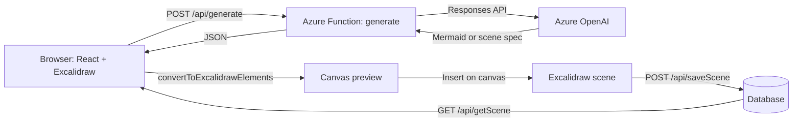

# Layr

> Describe a system. Get a diagram you can edit.

Layr is a private diagramming workspace built on the open-source
[Excalidraw](https://github.com/excalidraw/excalidraw) library. You type what
you want to see, an LLM generates a diagram, you review a preview, and it lands
on the canvas as normal, editable Excalidraw shapes. Workspaces are saved to a
database behind a GitHub sign-in.

---

## Table of contents

- [Layr](#layr)
  - [Table of contents](#table-of-contents)
  - [Credit and relationship to Excalidraw](#credit-and-relationship-to-excalidraw)
  - [Features](#features)
  - [How it works](#how-it-works)
  - [Tech stack](#tech-stack)
  - [Project structure](#project-structure)
  - [Getting started](#getting-started)
    - [Prerequisites](#prerequisites)
    - [Install](#install)
    - [Configure](#configure)
    - [Run locally](#run-locally)
  - [Configuration](#configuration)
  - [API reference](#api-reference)
    - [`POST /api/generate`](#post-apigenerate)
    - [`GET /api/listScenes`](#get-apilistscenes)
    - [`GET /api/getScene?topic=<name>`](#get-apigetscenetopicname)
    - [`POST /api/saveScene`](#post-apisavescene)
  - [Data model](#data-model)
  - [Authentication](#authentication)
  - [Deployment](#deployment)
  - [Roadmap](#roadmap)
  - [License](#license)
  - [Acknowledgements](#acknowledgements)

---

## Credit and relationship to Excalidraw

This project would not exist without Excalidraw. The infinite canvas, drawing
tools, hand-drawn rendering, element format, import and export, and the
Mermaid conversion (`@excalidraw/mermaid-to-excalidraw`) all come from the
Excalidraw team and its contributors, and are used under the MIT License.

This is an **independent project. It is not affiliated with or endorsed by
Excalidraw.** Excalidraw+ is the official hosted product from the Excalidraw
team and offers similar features, including AI diagrams. This repository is a
self-built version on top of the open-source library, made for learning and for
running your own private instance. If you want the official experience, use
[Excalidraw+](https://plus.excalidraw.com).

| From Excalidraw | Built in this project |
| --- | --- |
| Infinite canvas and drawing tools | Text-to-diagram generation with a preview step |
| Hand-drawn look and shape library | Edit a generated diagram by selecting it |
| Element format, import and export | Workspaces saved to a database |
| Mermaid to Excalidraw conversion | GitHub sign-in around the editor, landing page |

## Features

- **Text to diagram.** Describe an architecture, comparison or process. The
  model chooses between a Mermaid diagram and a hand-placed scene spec.
- **Preview before insert.** Generated output opens in a review pane. Your
  canvas is untouched until you click **Insert on canvas**.
- **Edit by selection.** Select any element of a generated diagram, switch to
  **Edit selection**, and describe the change. Only that diagram is replaced.
- **Many diagrams per canvas.** Each generated diagram keeps its own source and
  element IDs, so several can live next to ordinary hand-drawn work.
- **Saved workspaces.** Name a workspace, save it, and reopen it later. Saved
  workspaces keep the generated-diagram metadata, so they stay editable by
  prompt.
- **Private by default.** The editor and the API sit behind a GitHub sign-in.
- **Light and dark.** Both the landing page and the editor support themes.

## How it works



1. The browser sends your instruction (plus the current theme, and for edits
   the selected diagram's source) to `/api/generate`.
2. The function asks the model for either a **Mermaid** diagram with semantic
   tone assignments, or a **scene spec** with explicit elements.
3. Mermaid output is parsed in the browser with
   `@excalidraw/mermaid-to-excalidraw`, then styled with the server's tone
   palette. Scene output is used directly.
4. `convertToExcalidrawElements` turns the skeletons into real elements. They
   are centred on the viewport (or on the diagram being replaced) and shown in
   the preview.
5. **Insert on canvas** merges the elements into the scene. Saving writes the
   scene and the generated-diagram metadata through `/api/saveScene`.

## Tech stack

| Layer | Choice |
| --- | --- |
| UI | React, TypeScript, Vite |
| Canvas | `@excalidraw/excalidraw`, `@excalidraw/mermaid-to-excalidraw` |
| API | Azure Functions (Node.js) |
| LLM | Azure OpenAI (Responses API) |
| Auth and hosting | Azure Static Web Apps with GitHub sign-in |
| Storage | A database behind the Functions API (see [Data model](#data-model)) |

## Project structure

Adjust this to match your tree.

```text
.
├── src/
│   ├── App.tsx               # Routing, editor page, AI modal, diagram preview
│   ├── LandingPage.tsx       # Landing and sign-in page
│   ├── Landing.css           # Landing styles, scoped under .lp, light and dark
│   ├── AIWorkspacePanel.css  # AI launcher and modal styles
│   ├── App.css               # Editor shell styles
│   └── index.css             # Global resets
├── api/
│   ├── generate/             # LLM call, Mermaid or scene-spec output
│   ├── listScenes/           # GET  list saved workspaces
│   ├── getScene/             # GET  load one workspace
│   └── saveScene/            # POST save one workspace
├── staticwebapp.config.json  # Routes and auth rules
└── README.md
```

Routing is deliberately simple: `/editor` and `/editor/*` render the editor,
everything else renders the landing page.

## Getting started

### Prerequisites

- Node.js 20 or newer
- An Azure OpenAI resource with a deployed model
- A GitHub account (for sign-in)
- [Azure Static Web Apps CLI](https://github.com/Azure/static-web-apps-cli) and
  [Azure Functions Core Tools](https://learn.microsoft.com/azure/azure-functions/functions-run-local)
  for running locally

### Install

```bash
git clone <your-repo-url>
cd <your-repo>
npm install
(cd api && npm install)
```

### Configure

Create `api/local.settings.json` (never commit it). See
[Configuration](#configuration) for the values.

### Run locally

The SWA CLI serves the Vite app, the Functions API, and an emulated auth
endpoint on one origin, so `/api/*` and `/.auth/*` work the same as in
production.

```bash
swa start http://localhost:5173 --run "npm run dev" --api-location api
```

Open `http://localhost:4280`, click **Sign in with GitHub**, and use the
emulator's login form.

## Configuration

Names below are placeholders. Use the ones your Functions actually read.

| Setting | Purpose |
| --- | --- |
| `AZURE_OPENAI_ENDPOINT` | Your Azure OpenAI resource URL |
| `AZURE_OPENAI_API_KEY` | Key for that resource (prefer managed identity in production) |
| `AZURE_OPENAI_DEPLOYMENT` | Name of the model deployment |
| `<DB_CONNECTION_STRING>` | Connection to the database that stores workspaces |

Set these in `api/local.settings.json` locally and in the Static Web App's
application settings in Azure.

## API reference

All endpoints live under `/api` and require a signed-in user.

### `POST /api/generate`

Request:

```json
{
  "operation": "create",
  "topic": "RAG system with ingestion and query flows",
  "theme": "light"
}
```

For `"operation": "edit"`, also send `targetDiagramId` and either
`existingMermaid` or `existingSpec`.

Response is one of:

```json
{ "kind": "mermaid", "mermaid": "flowchart LR ...", "styles": [{ "id": "A", "label": "Docs", "tone": "default" }], "themeTones": {}, "themeEdges": { "edge": "#343a40", "text": "#1e1e1e" } }
```

```json
{ "kind": "scene", "elements": [], "spec": {} }
```

Errors return a non-2xx status with `{ "error": "message" }`. Requests over
8,000 characters are rejected client-side.

### `GET /api/listScenes`

Returns `[{ "topic": string, "updatedAt": string }]`.

### `GET /api/getScene?topic=<name>`

Returns the saved scene (see [Data model](#data-model)), or a non-2xx status if
it does not exist.

### `POST /api/saveScene`

Body is a scene document as described below. The workspace `topic` is its key.

## Data model

A saved workspace:

```ts
type SavedScene = {
  topic: string;                       // workspace name, used as the key
  elements: ExcalidrawElement[];       // the full canvas
  generatedDiagrams: {
    id: string;
    kind: "mermaid" | "scene";
    source: string;                    // Mermaid source (mermaid kind)
    spec?: Record<string, unknown>;    // scene spec (scene kind)
    elementIds: string[];              // which elements belong to this diagram
    createdAt: number;
  }[];
  appState: {
    viewBackgroundColor?: string;
    gridSize?: number | null;
    theme?: "light" | "dark";
  };
  // Legacy fields kept for older saves:
  mermaid?: string;
  mermaidElementIds?: string[];
};
```

`generatedDiagrams` is what makes edit-by-selection work: selecting any element
maps back to the diagram that owns it.

## Authentication

Sign-in is handled by Azure Static Web Apps, not by application code.

- The landing page sends users to
  `/.auth/login/github?post_login_redirect_uri=/editor`.
- The editor's log out button goes to
  `/.auth/logout?post_logout_redirect_uri=/`.
- Lock `/editor` and `/api` to signed-in users in
  `staticwebapp.config.json`. Example, match it to your actual file:

```json
{
  "routes": [
    { "route": "/editor*", "allowedRoles": ["authenticated"] },
    { "route": "/api/*", "allowedRoles": ["authenticated"] }
  ],
  "responseOverrides": {
    "401": {
      "redirect": "/.auth/login/github?post_login_redirect_uri=.referrer",
      "statusCode": 302
    }
  },
  "navigationFallback": {
    "rewrite": "/index.html",
    "exclude": ["/api/*", "/.auth/*", "*.{css,js,png,svg,woff2}"]
  }
}
```

If every GitHub user should not get in, restrict by role (invitations in Static
Web Apps) rather than leaving the `authenticated` role open.

## Deployment

1. Create an Azure Static Web App and connect this repository.
2. Build settings: app location `/`, API location `api`, output `dist`.
3. Add the [configuration](#configuration) values as application settings.
4. Push to the connected branch. The generated GitHub Actions workflow builds
   and deploys the app and the API.

## Roadmap

- [ ] Sharing a workspace with another user
- [ ] Export a generated diagram back to Mermaid
- [ ] Streaming generation instead of a single response
- [ ] Per-user quotas for model calls
- [ ] Tests for the generate endpoint's output validation

## License

Choose a license for your own code (MIT is a simple fit) and add a `LICENSE`
file.

This project includes and depends on Excalidraw, which is MIT licensed:
Copyright (c) 2020 Excalidraw. Keep its copyright and license notice with any
distribution that bundles it, and keep the credit on the landing page. Other
dependencies keep their own licenses.

## Acknowledgements

- [Excalidraw](https://github.com/excalidraw/excalidraw) and everyone who
  contributes to it
- [`@excalidraw/mermaid-to-excalidraw`](https://github.com/excalidraw/mermaid-to-excalidraw)
- [Mermaid](https://mermaid.js.org)
